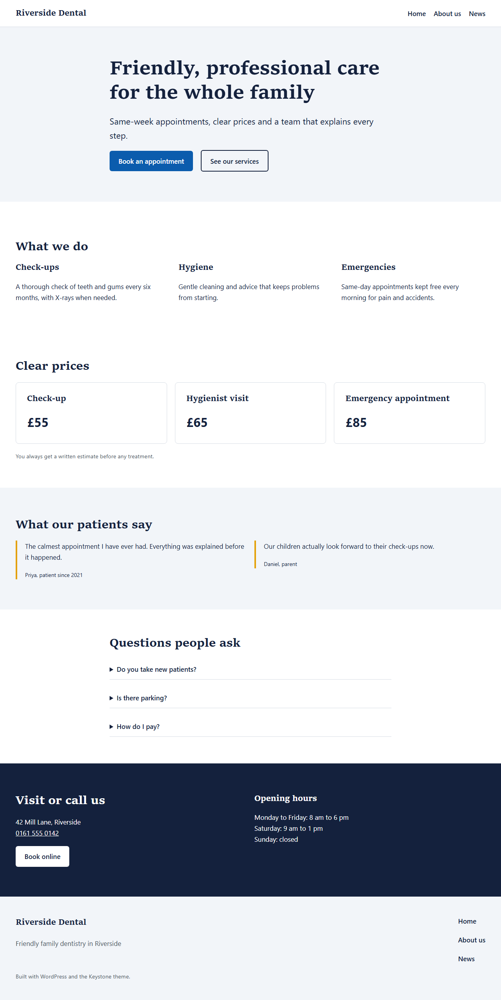
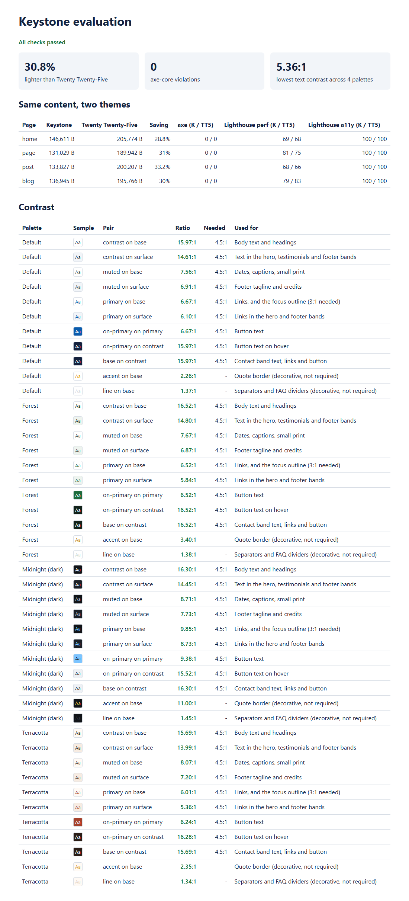
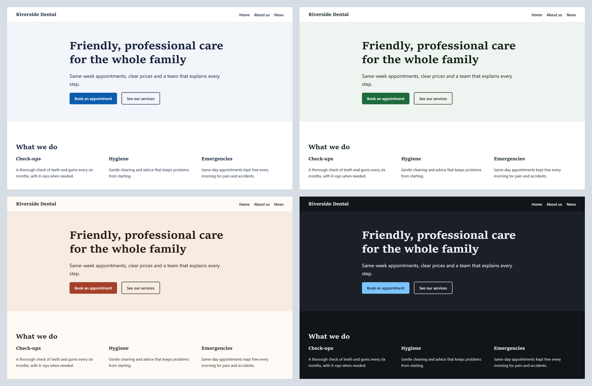
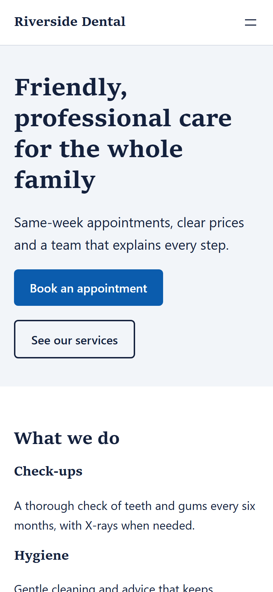

# Keystone: a fast, accessible WordPress block theme

[](https://github.com/codeROCK-IZZY/wordpress-block-theme/actions/workflows/ci.yml)


A full-site-editing theme for local service businesses (clinics, trades, studios, shops). It is built only from
`theme.json`, HTML templates and block patterns: **no theme JavaScript, no web fonts, under 30 lines of CSS**. It
includes six ready-made sections and three style variations, and every text colour in every variation passes
WCAG AA contrast.



## Results

Measured by `eval/compare.py` and `php eval/run.php --gate` in CI. Keystone and WordPress's default theme, Twenty
Twenty-Five, render **the same blocks and the same content** (see [ADR 3](docs/adr/0003-fair-comparison.md)):

| Page (same content) | Keystone | Twenty Twenty-Five | Saving | Web fonts downloaded |
|---|---:|---:|---:|---:|
| Home (all six patterns) | 146.6 KB | 205.8 KB | **28.8%** | 0 vs 53.6 KB |
| Page | 131.0 KB | 189.9 KB | **31.0%** | 0 vs 53.6 KB |
| Post | 133.8 KB | 200.2 KB | **33.2%** | 0 vs 53.6 KB |
| Blog | 136.9 KB | 195.8 KB | **30.0%** | 0 vs 53.6 KB |

| Check | Result |
|---|---:|
| Text/background pairs checked for contrast (4 palettes × 9 pairings) | **36 of 36 pass AA** (lowest 5.36:1) |
| axe-core WCAG 2.1 A/AA violations, four page types | **0** |
| Lighthouse accessibility (median of 3 mobile runs, every page) | **100** |
| Templates rendered over HTTP with one `<h1>`, a skip link and no PHP notices | **7 of 7** (home, page, post, blog, search, archive, 404) |
| WordPress Theme Check plugin | **no REQUIRED issues** |

The page-weight difference comes from what each theme adds: Twenty Twenty-Five downloads 54 KB of web fonts on
every page. Both themes load the same core JavaScript (the Navigation
block's mobile menu), so script weight is equal. The Lighthouse **performance** score is reported in the
evaluation report but not gated: on a shared machine the same page moves by 10+ points between runs.



## Style variations

Default, Forest, Terracotta and Midnight (dark). Each is one JSON file that fills the same eight colour slots, named
for their job (`base`, `surface`, `contrast`, `muted`, `primary`, `on-primary`, `accent`, `line`), so the dark
variation needs no CSS. Users pick one in **Appearance → Editor → Styles**.



## What is in the theme

| | |
|---|---|
| **Templates** | front page, blog home, single post, page, page without title, archive, search, 404, index |
| **Template parts** | header (site title and responsive navigation), footer (tagline, navigation, credit) |
| **Patterns** (Keystone sections) | hero with two calls to action, services in three columns, pricing cards, testimonials, FAQ (native `<details>`), contact band with opening hours |
| **Global styles** | type scale with fluid sizes, spacing scale, buttons, links with visible focus, quotes, separators, captions |
| **Style variations** | Forest, Terracotta, Midnight (dark) |

Design decisions:

- **System fonts** ([ADR 1](docs/adr/0001-system-fonts.md)). Text is drawn immediately, with no font requests and
  no layout shift from swapping fonts. A brand font can still be added from the Font Library.
- **Colour slots by role, with contrast enforced** ([ADR 2](docs/adr/0002-palette-slots.md)). The default palette
  and the custom colour picker are disabled, so editors stay on brand. `eval/run.php` checks the contrast of each
  pairing the templates and patterns use, in every palette, and CI fails below 4.5:1. The test of the test:
  changing Midnight's muted grey to `#555b63` makes the gate fail with *"muted on base is 2.69:1, needs 4.5:1"*.
- **Accessibility built in.** A skip link on every template, one `<h1>` per page, a visible focus outline on every
  focusable element, underlined links, `prefers-reduced-motion` respected, and an FAQ that works by keyboard
  without JavaScript.

<p align="center"></p>

## Run it

```bash
docker compose up -d
bash tests/integration/run.sh        # installs WordPress, adds demo content, runs every check
# open http://127.0.0.1:8080 (admin / admin)

docker compose exec -T cli wp eval-file tests/use-style.php "Midnight (dark)" --user=admin   # try a variation

# Comparison and evaluation (needs Python with Playwright, plus axe-core and Lighthouse from npm)
python eval/compare.py node_modules/axe-core/axe.min.js --lighthouse node_modules/lighthouse/cli/index.js
php eval/run.php --gate              # writes eval/reports/report.{md,json,html}
```

To install the theme on a site, download `keystone.zip` from the latest CI run (or zip the `keystone` folder) and
upload it in **Appearance → Themes → Add New Theme**.

## Tests and CI

- **Coding standards:** WordPress Coding Standards (WordPress-Extra) and PHP 8.1+ compatibility on the theme, tests
  and evaluation.
- **Inside WordPress** (`tests/integration/checks.php`): the theme is valid and is a block theme, every template is
  present, templates and parts use only registered blocks, all six patterns and three variations load, no web fonts
  are registered, and custom colours are off.
- **Over HTTP** (`tests/integration/run.sh`): seven URLs return the right status with one `<h1>`, a skip link and
  no PHP warnings; no theme JavaScript or web fonts on the page; the document language is set.
- **WordPress Theme Check**, the plugin the WordPress.org theme review uses.
- **Comparison and gate** on the latest WordPress; the theme checks also run on WordPress 6.6, the oldest version
  supported (theme.json v3).
- **gitleaks** secret scan of the full history.

## Project layout

```
keystone/                 the theme (this folder is what gets installed)
  theme.json              settings and styles
  templates/  parts/      block templates and template parts
  patterns/               six sections, translatable
  styles/                 Forest, Terracotta, Midnight
eval/compare.py           Keystone vs Twenty Twenty-Five: bytes, axe-core, Lighthouse
eval/run.php              contrast checks, report and gate
tests/integration/        demo content, checks inside WordPress, HTTP checks
docs/adr/                 design decisions
```

See [known limitations](docs/known-limitations.md).

## License

GPL-2.0-or-later.
